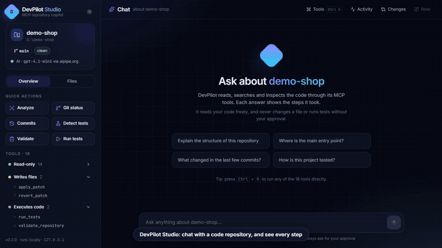
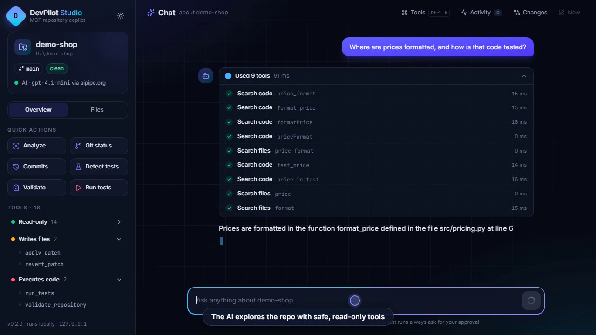
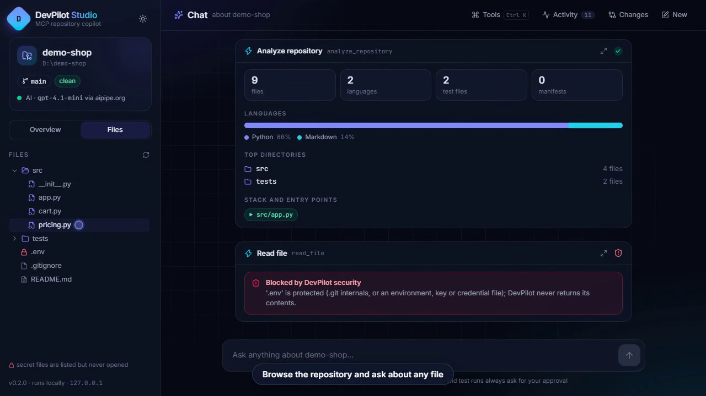
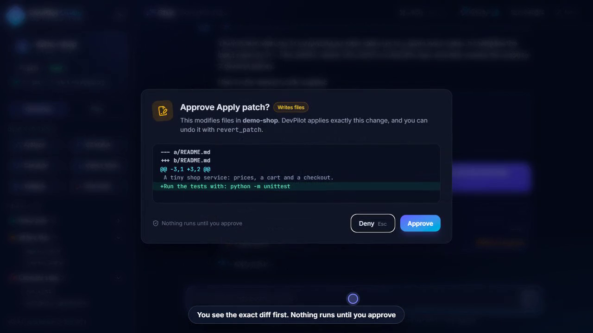

# DevPilot MCP

[](https://pypi.org/project/devpilot-mcp/)
[](https://github.com/KD-kaustubh/devpilot-mcp/actions/workflows/test.yml)
[](https://github.com/KD-kaustubh/devpilot-mcp/blob/main/LICENSE)

Chat with a code repository and watch exactly what the AI does. DevPilot lets an AI model read, search and inspect one repository through 18 safe tools, and it never changes a file or runs tests without your approval.

It has two parts:
- **DevPilot Studio:** a local web UI. This is the easiest way to use it (see below).
- **DevPilot MCP server:** the same 18 tools for any MCP client, such as Claude Code or Gemini.

<p align="center">
  
</p>
<p align="center"><a href="https://github.com/KD-kaustubh/devpilot-mcp/releases/download/v0.2.0/devpilot-studio-demo.mp4">Watch the full 85-second demo (MP4)</a></p>

## Quick start (recommended: the web UI)

Requires Python 3.10+ (3.11+ recommended). Git is needed for the Git tools.

```powershell
pip install "devpilot-mcp[ui]"
$env:DEVPILOT_WORKSPACE = "C:\path\to\your\repo"     # macOS/Linux: export DEVPILOT_WORKSPACE=/path/to/your/repo
devpilot-ui
```

Your browser opens at `http://127.0.0.1:8765`. Then:

1. **Try it right away, no account needed.** Click a quick action (Analyze, Git status, Commits), press **Ctrl+K** to run any tool, or open the **Files** tab to browse the code.
2. **Turn on AI chat (optional).** Get a free token at [aipipe.org/login](https://aipipe.org/login), then set it and restart:
   ```powershell
   $env:AIPIPE_TOKEN = "your-token"     # macOS/Linux: export AIPIPE_TOKEN=your-token
   devpilot-ui
   ```
3. **Ask a question,** like *"Where is authentication implemented?"* Each answer shows the steps the AI took.

Without a token, everything works except the chat. The full guide is in the [Web UI docs](https://github.com/KD-kaustubh/devpilot-mcp/blob/main/docs/UI.md).

## What DevPilot Studio gives you

- **Steps you can follow:** every answer lists the tools the AI used, with timings. Anything DevPilot's security refuses (for example reading `.env`) is shown as blocked.
- **Result cards, not JSON:** language bars, commit timelines, colored diffs, grouped search matches, test results.
- **Ctrl+K tool runner:** run any of the 18 tools through a form, no AI needed.
- **File explorer:** browse the repository, open files, and ask the AI about one.
- **Changes with Undo:** every patch the AI applied is listed with its diff and a one-click undo.
- **Approval first:** changes and test runs always wait for you to click **Approve**.

| Steps you can follow | Result cards, secrets blocked | Approval with the exact diff |
|---|---|---|
|  |  |  |

## Use DevPilot from an AI client (MCP)

The same tools work in any app that supports MCP over stdio. With Claude Code, for example:

```powershell
pip install devpilot-mcp
claude mcp add devpilot -e DEVPILOT_WORKSPACE=C:/path/to/your/repo -- devpilot-mcp
```

Then ask: *"Use DevPilot to analyze this repository and explain its structure."* You can also explore the tools by hand with MCP Inspector (`npx @modelcontextprotocol/inspector`). More in the [usage guide](https://github.com/KD-kaustubh/devpilot-mcp/blob/main/docs/USAGE.md).

> Always set `DEVPILOT_WORKSPACE` to the **absolute** path of the repository. If `devpilot-mcp` is not on your PATH (for example it is inside a virtual environment), give `claude mcp add` the full path to the `devpilot-mcp` executable instead.

## The 18 tools

| Tool | What it does | Access |
|------|--------------|--------|
| `list_directory` | List a directory | Read-only |
| `read_file` | Read a text file | Read-only |
| `search_files` | Search text in all files, optionally in one folder | Read-only |
| `search_code` | Smart-case search in source files | Read-only |
| `analyze_repository` | Languages, structure, manifests, tests, entry points | Read-only |
| `git_status` | Branch, staged, unstaged and untracked files | Read-only |
| `git_log` | Recent commits | Read-only |
| `git_diff` | Staged or unstaged changes | Read-only |
| `git_branch` | Local branches | Read-only |
| `github_repository` | GitHub metadata for `origin` | Read-only |
| `github_issues` | Recent issues | Read-only |
| `github_pull_requests` | Recent pull requests | Read-only |
| `investigate_repository` | Ranked evidence for a developer question | Read-only |
| `apply_patch` | Apply a unified diff you supply, atomically | Writes files |
| `revert_patch` | Undo an applied patch | Writes files |
| `get_test_commands` | Detect pytest/unittest (runs nothing) | Read-only |
| `run_tests` | Run the detected test command | Executes code |
| `validate_repository` | Validation report; tests only on request | Executes code |

DevPilot collects evidence and performs tightly bounded actions. The AI model does the reasoning, and it never writes a patch on DevPilot's behalf: patches come from the model or from you.

## Security at a glance

- Every path stays inside the workspace. `..`, absolute, drive and UNC paths, and escaping symlinks and junctions are rejected.
- `.env` files, private keys, credential files and `.git` internals are never read, searched or written.
- Changes and test runs need your explicit approval in the UI, and patches are validated in full and applied atomically.
- Only two places start processes: allowlisted read-only Git commands, and two fixed Python test commands. There is no shell and no caller-supplied command.
- GitHub access is HTTPS GET to `api.github.com` only, and the token never appears in output.
- The UI listens on `127.0.0.1` only, and your AI token stays on the server side.

**It is not a sandbox.** Tests run with DevPilot's own permissions and network access, and secret redaction is best-effort. See [Security](https://github.com/KD-kaustubh/devpilot-mcp/blob/main/docs/SECURITY.md) for the full model and known limitations.

## Run from source

```powershell
git clone https://github.com/KD-kaustubh/devpilot-mcp.git
cd devpilot-mcp
python -m venv .venv
.venv\Scripts\activate           # macOS/Linux: source .venv/bin/activate
pip install -e ".[ui]"
python -m unittest discover -s tests -t .
```

The UI frontend needs Node.js to rebuild (`cd ui && npm install && npm run build`); see [Development](https://github.com/KD-kaustubh/devpilot-mcp/blob/main/docs/DEVELOPMENT.md).

## Documentation

| Document | Contents |
|----------|----------|
| [Web UI](https://github.com/KD-kaustubh/devpilot-mcp/blob/main/docs/UI.md) | DevPilot Studio: setup, AI Pipe, approvals, safety, development |
| [Usage guide](https://github.com/KD-kaustubh/devpilot-mcp/blob/main/docs/USAGE.md) | Configuration, MCP Inspector, client setup, example workflows |
| [Tool reference](https://github.com/KD-kaustubh/devpilot-mcp/blob/main/docs/TOOLS.md) | Every tool's inputs, output examples and limits |
| [Security](https://github.com/KD-kaustubh/devpilot-mcp/blob/main/docs/SECURITY.md) | Security model, known limitations, security tests |
| [Development](https://github.com/KD-kaustubh/devpilot-mcp/blob/main/docs/DEVELOPMENT.md) | Architecture, running tests, CI, phase history |

## License

[MIT](https://github.com/KD-kaustubh/devpilot-mcp/blob/main/LICENSE)
